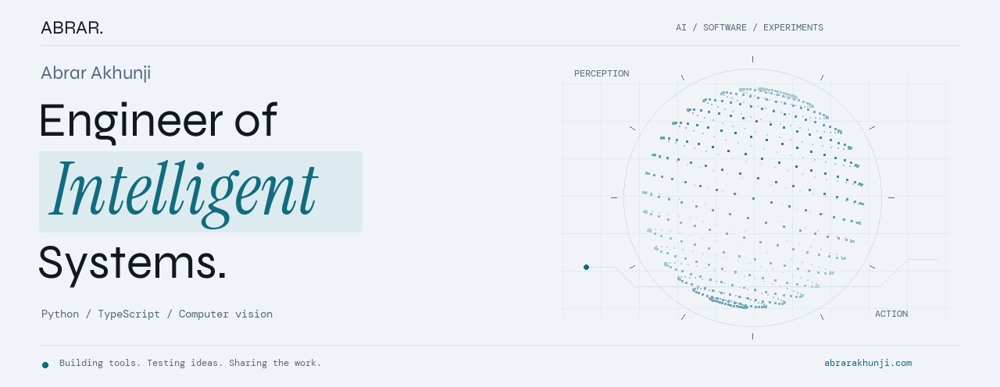

<a href="https://abrarakhunji.com/">
  <picture>
    <source media="(prefers-reduced-motion: reduce) and (prefers-color-scheme: dark)" srcset="assets/profile/hero-dark-still.png">
    <source media="(prefers-reduced-motion: reduce)" srcset="assets/profile/hero-light-still.png">
    <source media="(prefers-color-scheme: dark)" srcset="assets/profile/hero-dark.gif">
    
  </picture>
</a>

  <a href="https://abrarakhunji.com/"><b>Portfolio</b></a> &nbsp; / &nbsp;
  <a href="https://abrarakhunji.com/blog/"><b>Engineering notes</b></a> &nbsp; / &nbsp;
  <a href="https://www.linkedin.com/in/abrar-akhunji-1a116524b"><b>LinkedIn</b></a> &nbsp; / &nbsp;
  <a href="https://abrarakhunji.com/#contact"><b>Get in touch</b></a>

# Hi, I'm Abrar.

I build AI-powered developer tools, local voice experiences, and computer vision experiments. My work moves between **Python**, **TypeScript**, and the systems that turn a model into something people can use.

**Currently building:** FIXO_CLI, FixoFlow, and Rea API Studio.

---

## Selected work
Working software, with source and current limits.

### FIXO_CLI · the coding workspace, in your terminal

A TypeScript/Node.js coding agent with Tree-Sitter code analysis, implementation planning, tool execution, and multi-provider model routing.

**I created FIXO_CLI under my second account, [Abrar-Akhunji](https://github.com/Abrar-Akhunji).** The original repository lives there; this account also contains my fork. Both belong to my project history.

[**Original repository →**](https://github.com/Abrar-Akhunji/FIXO_CLI) &nbsp; [This account's copy](https://github.com/abrar225/FIXO_CLI) &nbsp; [Project website](https://fixo.firehox.com/)

Stack and operating limits

TypeScript · Node.js · Tree-Sitter · LLM APIs. Provider availability, quotas, credentials, and costs depend on configuration and current provider terms. See the repository for setup and supported behavior.

 

<table>
<tr>
<td width="50%" valign="top">

### FixoFlow
Speech → local recognition → your everyday apps

Offline English voice dictation with a personal dictionary, transcript history, and clipboard/paste integration.

[**Explore the project →**](https://github.com/abrar225/FixoFlow)  
[Website](https://fixoflow.tech) · [Download previews](https://github.com/abrar225/FixoFlow/releases)

**Experimental preview:** macOS Apple Silicon; Windows x64 and Ubuntu X11 previews. Multilingual/Hinglish support is planned.

</td>
<td width="50%" valign="top">

### Rea API Studio
Requests → traffic capture → inferred contracts

A local HTTP workbench with collections, request workflows, traffic capture, and inferred OpenAPI exports.

[**Explore the project →**](https://github.com/abrar225/rea-api-studio)  
[Static sample](https://abrar225.github.io/rea-api-studio/) · [Readiness](https://github.com/abrar225/rea-api-studio/blob/main/docs/PLATFORM_READINESS.md)

Run the Node.js application locally. Inferred contracts need review; the website is a sample preview.

</td>
</tr>
</table>

## In the lab
Computer vision, datasets, and experiments that teach me something.

- **[BreedAI](https://github.com/abrar225/Cattel_Breed_AI)** — Vision Transformer experiments for Indian cattle breed classification. Beta; results are assistive.
- **[FIFA 20 analytics](https://github.com/abrar225/FIFA-20-Player-Analysis-Clustering)** — player-data exploration, value prediction, and style clustering.

I aim for clear setup instructions, reproducible evaluation, and honest limits.

Other forks and technical exploration

These projects build on other maintainers' work. Their upstream authorship stays explicit.

- [OmniRoute fork](https://github.com/abrar225/OmniRoute) · [Original project](https://github.com/cheaper-inference/OmniRoute)
- [FixO voice-assistant fork](https://github.com/abrar225/FixO) · [Original project](https://github.com/ethanplusai/jarvis)
- [FixO-Room fork](https://github.com/abrar225/FixO-Room) · [Original project](https://github.com/MiniMax-AI/OpenRoom)

---

## Build with me

Useful contributions start with a concrete problem: a reproducible bug, a device-specific failure, a clearer example, or a focused improvement.

For FixoFlow reports, include your OS, release version, target app, and expected versus actual behavior. Review logs and recordings before sharing personal content.

[**Read my engineering notes →**](https://abrarakhunji.com/blog/) &nbsp; [Browse all projects](https://github.com/abrar225?tab=repositories) &nbsp; [Contact](https://abrarakhunji.com/#contact)

Original animated artwork, typography, and palette adapted from [my portfolio](https://abrarakhunji.com/). A static alternative is provided for reduced-motion preferences.

